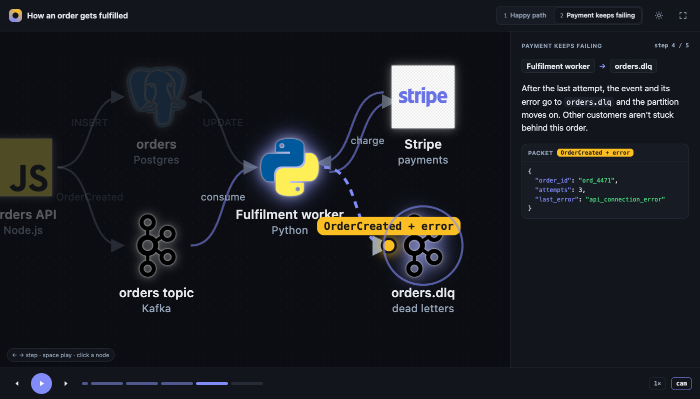

# motion-explainer

**Ask your coding agent how something works, and watch it run.**

<p align="center">
  
</p>

`motion-explainer` is an [Agent Skill](https://agentskills.io) for Claude Code, Codex CLI, Cursor, Gemini CLI and other agents that read `SKILL.md`. When you ask *"how does login work in this repo?"*, the agent reads the code and produces an animated, step-through explainer:

- packets travel along the real request/data path, with the payload shown at each hop
- narration explains *why* each step happens, not just what
- `file:line` links open the relevant code in VS Code
- multiple flows (happy path, failure path) appear as tabs
- a **What to do next** card says where to make your change
- it's one offline `index.html` with no server or account; commit it or send it to a teammate

Diagrams are laid out and drawn by [Kymo](https://github.com/kymostudio/kymostudio), including 2,000+ cloud and brand icons. The step model, animation and player are this project's.



*The player, built from the [`order-queue`](skills/motion-explainer/examples/order-queue) example. This is step 4 of the "payment keeps failing" flow.*

## Install

You need Node 18 or newer. There are no npm dependencies.

```bash
git clone https://github.com/bilaltahseen/motion-explainer
node motion-explainer/skills/motion-explainer/scripts/install.mjs
```

The installer detects which agents you have and copies the skill into each one's skills folder:

| Agent | Location |
|---|---|
| Claude Code | `~/.claude/skills/motion-explainer` |
| Codex CLI | `~/.codex/skills/` and `~/.agents/skills/` |
| Gemini CLI | `~/.gemini/skills/` |
| Cursor | `~/.cursor/skills/` |

Options: `--project [dir]` installs into one repo (`.claude/skills` and `.agents/skills`), `--link` symlinks instead of copying (for hacking on it), and `--uninstall` removes it. You can also copy `skills/motion-explainer/` to any of those folders by hand.

## Use

Ask in plain words:

> *Explain how checkout works in this repo, animated.*
> *Walk me through what happens when a Stripe webhook arrives.*
> *I'm a visual learner. Show me how the auth middleware works.*

The agent writes `explainers/<slug>/diagram.kymo` and `explainer.json`, runs the build, and opens `explainers/<slug>/index.html`.

**Player keys:** `→`/`←` step · `space` play/pause · `1–9` switch flow · click a node for details · `c` camera follow · `t` theme · `f` fullscreen. Links like `index.html#checkout/4` jump straight to a step.

To change an explainer, ask the agent, or edit the two source files and rebuild:

```bash
node ~/.claude/skills/motion-explainer/scripts/build.mjs explainers/checkout --open
```

## Examples

Build any of these, then open the result:

```bash
node skills/motion-explainer/scripts/build.mjs skills/motion-explainer/examples/order-queue --open
```

- `order-queue`: checkout → Kafka → worker → Stripe, plus a retry and dead-letter failure path
- `oauth-login`: OAuth 2.0 + PKCE with a backend-for-frontend, plus how an API call works afterwards
- `build-pipeline`: how this skill turns a spec into a player

## Privacy

To lay out the diagram, the build sends `diagram.kymo` to Kymo's public renderer at `render.kymo.studio`. That file holds component names and edge labels only, never your source code. To keep everything local, set `MOTION_EXPLAINER_OFFLINE=1` (or pass `--offline`). It then renders with `npx kymostudio`, and only Kymo's built-in glyphs are available.

## How it works

```
explainer.json ─┐
                ├─ build.mjs ─ validate ─ render (Kymo API → SVG, cached) ─ tag ids ─ player.html → index.html
diagram.kymo ───┘
```

Kymo's SVG has no element ids. `tag-svg.mjs` identifies nodes by their labels and edges by endpoint geometry, so the player can move packets along the actual drawn curves. It also patches a few Kymo renderer gaps. Details are in [AGENTS.md](AGENTS.md).

## Develop

```bash
node scripts/check.mjs            # self-test: every example builds with zero warnings
```

See [AGENTS.md](AGENTS.md) for the repo layout, conventions and the Kymo quirks we handle.

## License

MIT. Diagrams are rendered by [Kymo](https://github.com/kymostudio/kymostudio) (Apache-2.0).
